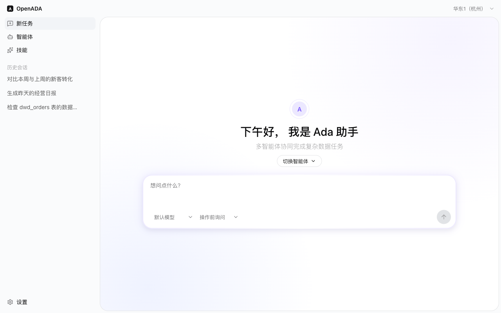

<div align="center">

# OpenADA

**在本机使用阿里云 ADA 的轻量开源客户端**

克隆代码，填入 AccessKey，就能在浏览器里和数据智能体对话、审批操作、管理智能体和技能。

[](LICENSE)
[](package.json)
[](https://help.aliyun.com/zh/ada/developer-reference/api-ada-2026-07-01-overview)

[快速开始](#快速开始) · [功能](#功能) · [配置](#配置) · [常见问题](#常见问题) · [安全](#安全) · [开发](#开发)



<sub>截图来自 `npm run demo`，其中的数据都是虚构的。</sub>

</div>

## 为什么选择 OpenADA

- **克隆即用**：没有数据库，不用部署服务。一条 `npm start` 就能在本机打开完整界面。
- **密钥不离开本机**：AccessKey 保存在本地网关里，请求在本机签名后直接发往阿里云，浏览器页面拿不到密钥。
- **完整的会话体验**：流式回复、思考和工具步骤、操作审批、问答卡片、停止回合、断线续传，以及派发给其他智能体后自动显示结果。
- **没有 AccessKey 也能试**：`npm run demo` 使用内置的模拟服务，不会向阿里云发送任何请求。
- **基于公开接口**：只调用公开的 [`Ada/2026-07-01` OpenAPI](https://help.aliyun.com/zh/ada/developer-reference/api-ada-2026-07-01-overview)。网关的签名实现已用阿里云文档里的官方示例校验。

> 智能体运行在阿里云上，OpenADA 只是客户端。调用产生的费用和创建的资源都归属于你的阿里云账号。

## 快速开始

需要 Node.js 22.18 或更高版本，并已[开通 ADA 服务](https://help.aliyun.com/zh/ada/)。

```bash
git clone https://github.com/aliyun/ai-data-service.git
cd ai-data-service
npm ci
npm start
```

打开 <http://127.0.0.1:8787>，填入 AccessKey 并选择地域。凭证验证通过后才会保存。

### 让 AI 助手帮你启动

把下面这段提示词复制给 Codex、Claude Code、Cursor 等支持操作本地终端的 AI 助手：

```text
请帮我在本地安装并启动 OpenADA，仓库地址是：https://github.com/aliyun/ai-data-service.git。

如果当前目录已经是这个仓库，请直接使用；否则克隆到 ai-data-service 目录。
先阅读仓库里的 README.md 和 AGENTS.md，检查 Node.js 是否满足要求，再安装依赖并在后台启动服务。

启动后，请通过 /api/config 确认服务就绪，把本地访问地址告诉我。
如果还没有配置阿里云凭证，让我自己在浏览器页面上填写 AccessKey 和地域；不要向我索要密钥，也不要读取或打印凭证文件。
如果我只是想先体验，请使用 npm run demo，它不需要 AccessKey。

遇到问题请根据实际报错排查。不要修改产品代码、覆盖已有凭证，或把服务暴露到公网。
```

**还没有 AccessKey？** 先用模拟服务体验：

```bash
npm run demo
```

在 demo 里发送包含下面关键词的消息，可以触发对应的场景：

| 关键词 | 场景 |
| --- | --- |
| `审批` | 工具执行前请求审批 |
| `提问` | 智能体向你提问（单选和多选） |
| `断流` | 连接中途断开，自动续传 |
| `失败` | 回合执行失败 |
| `慢` | 长回复，用来试“停止” |

## 功能

| 模块 | 能力 |
| --- | --- |
| 对话 | 流式回复，思考和工具步骤折叠展示，会话历史，停止回合，断线自动续传 |
| 人工确认 | 工具审批和问答卡片。默认逐次询问；“总是允许”类选项会单独提示；自动批准需要手动开启 |
| 多智能体 | 任务派发给其他智能体后，结果回来时自动显示 |
| 模型 | 按会话切换模型和思考强度 |
| 智能体 | 列表、搜索、详情、新建、编辑、删除；绑定技能、MCP Server、Connector 和知识库；编辑冲突时提示 |
| 技能 | 列表、搜索、详情、新建、编辑、删除；内容来源支持 Markdown 和公网 HTTPS ZIP 链接 |
| 地域 | 华东1（杭州）、华东2（上海）、华北2（北京） |

## 配置

### 凭证

两种方式任选：

- **在页面上填写**：首次打开时填写；之后可以在“设置”里更换或移除。凭证保存在仓库根目录的 `.env.local`，权限为 `600`，已被 Git 忽略。
- **使用环境变量**：优先级高于页面。此时页面只显示脱敏后的 AccessKey ID，不能修改凭证。

```bash
cp .env.example .env.local   # 或者直接 export 下面的变量
```

| 变量 | 说明 |
| --- | --- |
| `ALIBABA_CLOUD_ACCESS_KEY_ID` | AccessKey ID |
| `ALIBABA_CLOUD_ACCESS_KEY_SECRET` | AccessKey Secret |
| `ALIBABA_CLOUD_SECURITY_TOKEN` | 可选。使用 STS 临时凭证时填写 |
| `ADA_REGION` | `cn-hangzhou`（默认）、`cn-shanghai` 或 `cn-beijing`。通过环境变量设置后，页面不能切换地域 |

> **使用 STS 临时凭证时**：网关不会自动刷新凭证。凭证过期后，所有请求都会失败。通过页面配置的，在“设置”里重新填写即可；通过环境变量传入的，需要更新变量后重启。

### 其他选项

| 变量 | 说明 |
| --- | --- |
| `OPEN_ADA_PORT` | 网关端口，默认 `8787` |
| `OPEN_ADA_ENDPOINT` | 自定义 ADA 接入地址，例如 VPC 地址 `https://ada-vpc.cn-hangzhou.aliyuncs.com/`。只接受 https 地址，或本机（loopback）的 http 地址 |
| `OPEN_ADA_ENV_FILE` | 凭证文件路径，默认是仓库根目录的 `.env.local` |
| `OPEN_ADA_DEV_PORT` | `npm run dev` 的 Vite 端口，默认 `5173` |
| `OPEN_ADA_MOCK_PORT` | `npm run demo` 的模拟服务端口，默认 `8788` |

### RAM 权限

请使用[只有所需权限的 RAM 用户](https://help.aliyun.com/zh/ram/user-guide/create-a-ram-user)，不要使用主账号的 AccessKey。

公开元数据列出了智能体、技能等接口的权限点，比如 `ada:ListAgents`、`ada:CreateAgent`、`ada:GetSkill`。会话和模型接口的文档目前写的是“暂无授权信息透出”，所以这里给不出精确的最小权限策略。测试时可以先用下面的策略，正式使用前再按需收紧：

```json
{
  "Version": "1",
  "Statement": [
    { "Effect": "Allow", "Action": "ada:*", "Resource": "*" }
  ]
}
```

## 常见问题

<details>
<summary><b>保存凭证时提示 <code>InvalidAccessKeyId.NotFound</code> 或 <code>SignatureDoesNotMatch</code></b></summary>

AccessKey ID 或 Secret 填错了，或者这对 AccessKey 已被禁用。请在 [RAM 控制台](https://ram.console.aliyun.com/)核对。验证失败的凭证不会被保存，原来可用的凭证不受影响。
</details>

<details>
<summary><b>页面报 <code>Forbidden</code></b></summary>

当前 RAM 用户没有对应接口的权限。根据错误信息和 RequestId 调整策略，参见 [RAM 权限](#ram-权限)。
</details>

<details>
<summary><b>用了一段时间后，所有请求突然都失败了</b></summary>

如果用的是 STS 临时凭证（包括 aliyun CLI 的 OAuth 登录得到的凭证），很可能是凭证过期了。参见[凭证](#凭证)。
</details>

<details>
<summary><b>保存智能体时提示 <code>Agent.VersionConflict</code></b></summary>

这个智能体在你打开编辑器之后被别处修改过。关闭编辑器，重新打开，确认最新内容后再保存。
</details>

<details>
<summary><b>发消息时提示“会话正在执行或等待确认，消息未发送”</b></summary>

同一个会话在别的页面或客户端里还在运行，或者正在等待审批。消息不会发出，原文会放回输入框，等对方结束后再发送即可。
</details>

<details>
<summary><b>连接中断了，回答还会继续吗？</b></summary>

会。断开连接不会取消回合。页面会按服务端提供的续传游标自动接上，不会重复发送消息。如果自动重连多次仍失败，页面会显示“重新连接”按钮。
</details>

<details>
<summary><b>切换地域后，智能体和会话都不一样了</b></summary>

这是正常的。智能体、技能和会话都归属于地域，不同地域的数据彼此独立。如果某个地域没有开通 ADA，请求会报错。
</details>

<details>
<summary><b>启动时提示端口被占用</b></summary>

用 `OPEN_ADA_PORT` 换一个端口，例如 `OPEN_ADA_PORT=8790 npm start`。
</details>

<details>
<summary><b>删除智能体的 MCP Server 后，智能体用不了平台工具了</b></summary>

新建的智能体默认带有平台工具集 `ada-official`。编辑时清空 MCP Server，会把它一起删掉。
</details>

## 安全

本地网关持有 AccessKey，并代替浏览器签名请求，因此做了以下限制：

- 只监听 `127.0.0.1`，不能配置成监听其他地址。
- 校验 `Host` 和 `Origin`，并要求 JSON 请求体，防止其他网页和 DNS 重绑定攻击访问网关。
- 网关不是通用的签名服务：浏览器只能调用白名单里的接口和参数，见 [`server/actions.ts`](server/actions.ts)。
- 密钥不会返回给浏览器，也不会写进日志。
- 智能体的输出按不可信内容处理：不渲染原始 HTML，图片只显示为链接；CSP 禁止页面加载外部资源，防止数据通过图片地址外泄。

网关没有登录机制。**同一台机器上的其他本地进程也能访问它**，所以不要在共享机器上使用长期有效的 AccessKey。

## 架构

```text
浏览器（React）  ──>  本地网关（Node.js，127.0.0.1）  ──ACS3 签名──>  ada.<region>.aliyuncs.com
```

| 目录 | 内容 |
| --- | --- |
| [`server/`](server) | 网关：V3 签名、接口白名单、凭证存储、SSE 代理。除 Node.js 外没有运行时依赖 |
| [`web/`](web) | 界面。[`web/lib/session-controller.ts`](web/lib/session-controller.ts) 实现文档规定的流式规则：按调用 Id 识别终态、断线后续传、绝不重复发送消息 |
| [`scripts/`](scripts) | 模拟服务、demo、开发和冒烟测试脚本 |

已发布的 `@alicloud/ada20260701` 1.0.0 SDK 不包含会话和 SSE 接口，所以这里直接实现了 [V3 签名](https://help.aliyun.com/zh/sdk/product-overview/v3-request-structure-and-signature)，并用文档中的示例校验。

## 开发

```bash
npm run dev         # 网关 + Vite 热更新，打开 http://127.0.0.1:5173
npm run typecheck
npm test
npm run build
```

### 对真实服务做冒烟测试

测试和 demo 用的模拟服务是按公开文档编写的，不能证明和线上服务完全一致。对接口有疑问时，可以用自己的凭证运行：

```bash
npm run smoke                          # 只读检查
npm run smoke -- --chat <智能体名称>    # 新建会话、发一条消息、再删除会话
npm run smoke -- --write               # 新建临时技能和智能体，读回校验后删除
```

- 脚本从环境变量或 `.env.local` 读取凭证，**不会读取 aliyun CLI 的 profile**。
- 如需指定地域或接入地址，可以同时设置 `ADA_REGION` 和 `OPEN_ADA_ENDPOINT`。
- `--chat` 和 `--write` 会在你的账号下创建资源并调用模型，可能产生费用。临时资源的名称以 `open-ada-smoke-` 开头；如果脚本中途失败，请手动清理。

## 参与贡献

欢迎提交 Issue 和 Pull Request。提交前请确认 `npm run typecheck` 和 `npm test` 都已通过；改动界面时，请附上 `npm run demo` 下的截图。

## 许可证

[Apache License 2.0](LICENSE)
